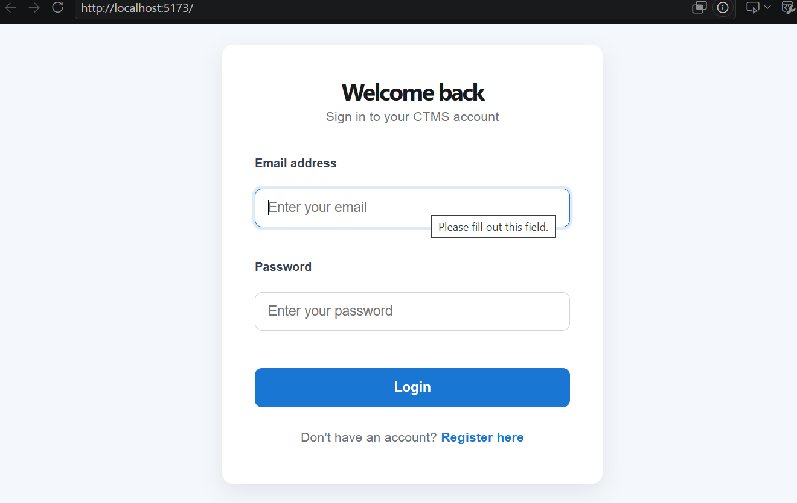
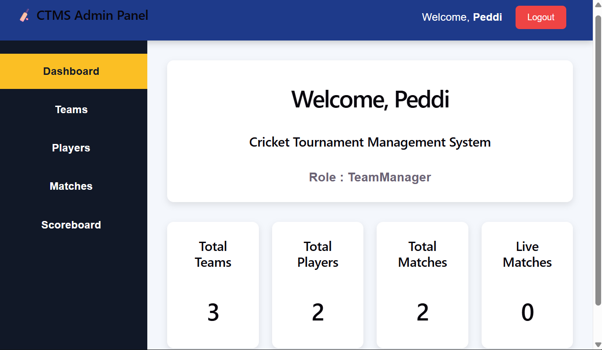
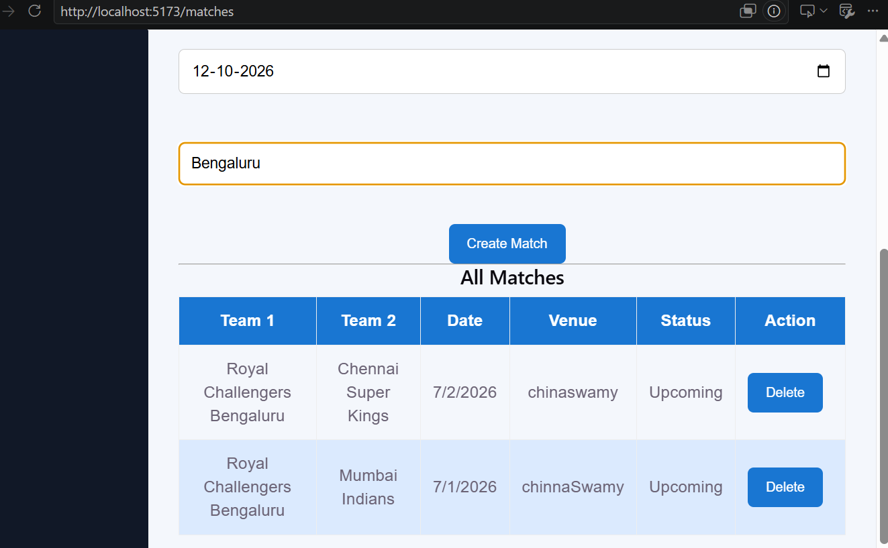
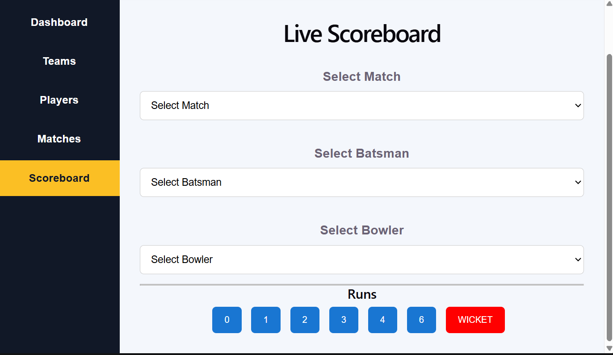

# 🏏 Cricket Tournament Management System (CTMS)

A full-stack MERN application for managing cricket tournaments. Team managers can register teams and players, schedule matches, and record ball-by-ball scores on a live scoreboard, all from a single d...

[Report Bug](https://github.com/Angajala-Peddiraju/Cricket-Tournament-Management-System/issues) · [Request Feature](https://github.com/Angajala-Peddiraju/Cricket-Tournament-Management-System/issues)

---

## Table of Contents

- [Overview](#overview)
- [Key Features](#key-features)
- [Screenshots](#screenshots)
- [Tech Stack](#tech-stack)
- [System Architecture](#system-architecture)
- [Project Structure](#project-structure)
- [Getting Started](#getting-started)
- [Environment Variables](#environment-variables)
- [API Modules](#api-modules)
- [Security](#security)
- [Future Enhancements](#future-enhancements)
- [Author](#author)

---

## Overview

Running a cricket tournament usually means juggling spreadsheets, manual score sheets, and repeated updates. CTMS brings team management, match scheduling, and live scoring into one web application.

The React frontend (built with Vite) talks to a RESTful Node.js and Express backend over Axios. Data is stored in MongoDB through Mongoose, and access is protected with JWT authentication and role-bas...

---

## Key Features

- **Authentication:** Register and log in securely with JWT-based sessions.
- **Role-Based Access:** The dashboard adapts to the logged-in user's role (for example, TeamManager).
- **Dashboard Overview:** At-a-glance counters for total teams, total players, total matches, and live matches.
- **Team Management:** Create and manage tournament teams.
- **Player Management:** Register players and assign them to teams.
- **Match Scheduling:** Create matches by choosing two teams, a date, and a venue. Each match shows a status (such as Upcoming) and can be deleted.
- **Live Scoreboard:** Select a match, batsman, and bowler, then record each delivery with 0, 1, 2, 3, 4, or 6 runs, or a wicket.

---

## Screenshots

| Login | Dashboard |
|---|---|
|  |  |

| Match Scheduling | Live Scoreboard |
|---|---|
|  |  |

---

## Tech Stack

| Layer | Technologies |
|---|---|
| Frontend | React.js, Vite, Axios, HTML5, CSS3 |
| Backend | Node.js, Express.js |
| Database | MongoDB (Atlas), Mongoose |
| Authentication | JSON Web Tokens (JWT) |
| Tools | Git, GitHub, Postman, VS Code, Nodemon |

---

## System Architecture

```
┌──────────────┐    HTTP / Axios    ┌────────────────────┐    Mongoose    ┌───────────────��[...]
│  React.js    │ ─────────────────► │  Express.js REST   │ ─────────────► │ MongoDB Atlas │
│  (Vite)      │ ◄───────────────── │  API (Node.js)     │ ◄───────────── │               │
└──────────────┘        JSON        └────────────────────┘                └───────────────��[...]
                                       │
                                       └── JWT Auth + Role-Based Access Control
```

---

## Project Structure

```
Cricket-Tournament-Management-System/
├── client/                    # React frontend (Vite)
├── server/                    # Express backend
│   ├── config/                # Database configuration
│   ├── controllers/
│   │   ├── authController.js
│   │   ├── dashboardController.js
│   │   ├── matchController.js
│   │   ├── playerController.js
│   │   ├── scoreboardController.js
│   │   └── teamController.js
│   ├── middlewares/           # JWT and role checks
│   ├── models/
│   │   ├── match.js
│   │   ├── player.js
│   │   ├── scoreboard.js
│   │   ├── team.js
│   │   └── user.js
│   └── server.js
├── postman/                   # API request collections
└── README.md
```

---

## Getting Started

### Prerequisites

- Node.js (v18 or later recommended)
- npm
- A MongoDB database (local or [MongoDB Atlas](https://www.mongodb.com/atlas))

### Installation and Run

1. **Clone the repository**

   ```bash
   git clone https://github.com/Angajala-Peddiraju/Cricket-Tournament-Management-System.git
   cd Cricket-Tournament-Management-System
   ```

2. **Start the backend**

   ```bash
   cd server
   npm install
   npm run dev
   ```

   After you create the `.env` file (see below), the terminal should show:

   ```
   Server is running on http://localhost:5000
   MongoDB Connected: <your-cluster-host>
   ```

3. **Start the frontend** (in a second terminal)

   ```bash
   cd client
   npm install
   npm run dev
   ```

4. **Open the app** at [http://localhost:5173](http://localhost:5173)

---

## Environment Variables

Create a `.env` file inside the `server` folder:

```env
PORT=5000
MONGO_URI=your_mongodb_connection_string
JWT_SECRET=your_secret_key
```

> Never commit your `.env` file. Make sure it is listed in `.gitignore`.

---

## API Modules

The backend is organized into feature-based controllers:

| Module | Responsibility |
|---|---|
| Auth | User registration and login, JWT issuing |
| Dashboard | Counts for teams, players, matches, and live matches |
| Teams | Create, view, and manage teams |
| Players | Register and manage players |
| Matches | Schedule, list, and delete matches |
| Scoreboard | Record runs and wickets for a selected match |

API requests can be tested with the Postman collections in the `postman/` folder.

---

## Security

- Protected routes require a valid JWT.
- Role-based middleware restricts actions based on the user's role.
- Credentials and secrets are stored in environment variables, not in the source code.

---

## Future Enhancements

- Automated points table and team standings
- Detailed player statistics and performance charts
- Real-time score broadcasting with WebSockets
- Knockout and group-stage fixture generation
- Automated testing and CI/CD pipeline

---

## Author

**Peddiraju Angajala**
B.Tech CSE (AI/ML), VIT-AP University

[GitHub](https://github.com/Angajala-Peddiraju) · [LinkedIn](https://www.linkedin.com/in/peddiraju-angajala) · peddirajuangajala@gmail.com

---

⭐ If you found this project useful, consider giving it a star.
